## Kaique Gomes

**`Data Engineering`**

###

<picture>
  <source media="(prefers-color-scheme: dark)" srcset="https://raw.githubusercontent.com/kngomes/kngomes/output/pacman-contribution-graph-dark.svg">
  <source media="(prefers-color-scheme: light)" srcset="https://raw.githubusercontent.com/kngomes/kngomes/output/pacman-contribution-graph.svg">
  
</picture>

###

 

  Hello World! 👋
    
  Hi, I'm Kaique!
    
  I'm a Junior Data Engineer focused on building a strong foundation in SQL, Python, and data management.
    
  I'm interested in understanding how data is collected, stored, transformed, and processed through different systems. I'm currently expanding my knowledge of databases, ETL/ELT processes, data pipelines, and data warehousing.
    
  Here on my GitHub, you'll find projects and experiments that showcase my technical growth, problem-solving skills, and journey in Data Engineering.

  
  <!--  -->

### 🛠️ Languages & Technologies

  
  
  

###

---
**📊 Estatísticas**

  
  

###
